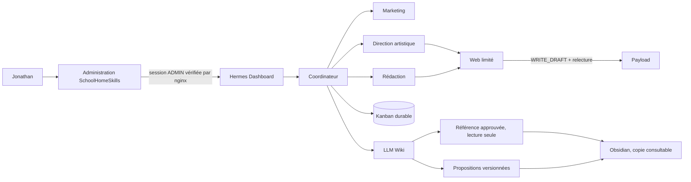

# SchoolHomeSkills — Hermes, LLM Wiki et Obsidian

Architecture de référence pour faire de Hermes Agent l’espace de conversation et de coopération, conserver les connaissances dans un LLM Wiki gouverné, et examiner une copie du Wiki avec Obsidian.

Ce dépôt est volontairement public et ne contient ni secret, ni session Hermes, ni base, ni journal d’exploitation, ni sauvegarde, ni document client, ni rapport personnel, ni copie du Wiki réel. Les exemples sont fictifs.

## État du pilote

- Version Hermes épinglée : `v0.21.6` (`sha256:55e192fba0cd4fde61142abbff5adeacff40efdb482ccd0ff877924bd274f909`).
- Inférence : abonnement ChatGPT/Codex via `openai-codex`, modèle vérifié `gpt-6.1-sol`, sans clé API active ni fournisseur de repli.
- Profils séparés : `coordinateur`, `marketing`, `redaction`, `directionartistique`, plus `web` limité aux brouillons.
- Wiki serveur : référence en lecture seule, propositions et livrables séparés.
- Coordination : Kanban Hermes durable pour les tâches techniques ; les validations métier exactes restent appliquées par le moteur SchoolHomeSkills.
- Payload 3.90.2 : service privé sur `127.0.0.1:3001`, brouillon technique écrit et relu ; publication jamais implicite.
- Portail : site vitrine public sur HTTPS, administration authentifiée et garde d’accès obligatoire devant Hermes.

## Architecture



Hermes fournit nativement les profils isolés, le Kanban partagé, les dépendances, les commentaires, les demandes de revue, les reprises, l’arrêt d’urgence, les sessions, les journaux et les sauvegardes. SchoolHomeSkills conserve les contrôles métier : organisation, version exacte approuvée, portée et expiration de l’accord, idempotence, écriture/relecture Payload et preuve d’exécution.

## Installation

1. Lire [`docs/architecture-et-limites.md`](docs/architecture-et-limites.md).
2. Auditer le serveur et sauvegarder ses configurations.
3. Adapter les variables non secrètes de [`deploy/install.sh`](deploy/install.sh), puis l’exécuter avec un compte sudo.
4. Configurer l’authentification publique OAuth/OIDC de Hermes de façon interactive. Ne pas exposer le tableau de bord avec le simple fournisseur mot de passe sur Internet.
5. Installer les contrats de profils avec [`deploy/install-agent-contracts.sh`](deploy/install-agent-contracts.sh).
6. Copier le Wiki privé hors de ce dépôt avec [`deploy/install-private-wiki.sh`](deploy/install-private-wiki.sh).
7. Tester avec [`tests/run.sh`](tests/run.sh), puis suivre [`docs/pilote.md`](docs/pilote.md).

## Accès et authentification

Le site vitrine est servi sur `https://vps-f61d79c0.vps.ovh.net/`. Le tableau de bord Hermes écoute uniquement sur `127.0.0.1:9119` côté hôte et nginx le transmet sur `https://vps-f61d79c0.vps.ovh.net:9443/`. Avant chaque transmission, nginx interroge la session du portail et exige le rôle `ADMIN`; sinon il redirige vers `/connexion-admin?next=hermes`. Hermes conserve ensuite sa propre authentification OAuth Nous Portal en défense en profondeur. Les routes `/api/plugins/` restent refusées par nginx.

Pour un contrôle local de secours sans passer par l'adresse publique :

```bash
ssh -L 9119:127.0.0.1:9119 ubuntu@votre-vps
```

Puis ouvrir `http://127.0.0.1:9119`.

## Utilisation

Dans Hermes, choisir le profil `coordinateur` et tester :

> Prépare une page en brouillon présentant mon diagnostic d’automatisation. Consulte d’abord l’index du Wiki et cite les sources approuvées. Fais valider le brief avant de lancer en parallèle la direction artistique et la rédaction. Assemble ensuite une proposition Web, mais n’écris dans Payload qu’après mon autorisation exacte et ne publie jamais.

## Exploitation

- Installation des commandes et de la sauvegarde quotidienne : `sudo deploy/install-operations.sh`
- État : `sudo /usr/local/sbin/shs-hermes-status`
- Journaux : `sudo docker logs --tail 200 hermes`
- Arrêt d’urgence : `sudo docker exec hermes hermes pause`
- Reprise : `sudo docker exec hermes hermes resume`
- Sauvegarde : `sudo /usr/local/sbin/shs-hermes-backup`
- Sauvegarde Payload : `sudo /usr/local/sbin/shs-payload-backup`
- Sauvegarde portail : `sudo /usr/local/sbin/shs-portal-backup`
- Restauration : voir [`docs/exploitation.md`](docs/exploitation.md)

## Limites importantes

- Le dashboard Web intègre le TUI et la gestion des profils, sessions, outils, mémoire, journaux, analytics, cron et Kanban. Il ne constitue pas une GED complète pour tous les documents, images et vidéos.
- Les routes de plugins Hermes doivent être protégées par la couche d’accès externe ; ne pas présumer que toutes héritent de l’authentification du dashboard.
- Le Kanban Hermes ne remplace pas les validations métier SchoolHomeSkills tant que les contrats et contrôles serveur ne sont pas raccordés.
- Aucun appel IA payant, publication, message externe, WhatsApp ou Teams n’est activé par ce dépôt.
- Aucun choix de licence n’a été fait pour le code propre à SchoolHomeSkills. En l’absence de fichier `LICENSE`, les droits restent réservés. Les composants tiers conservent leurs licences.
